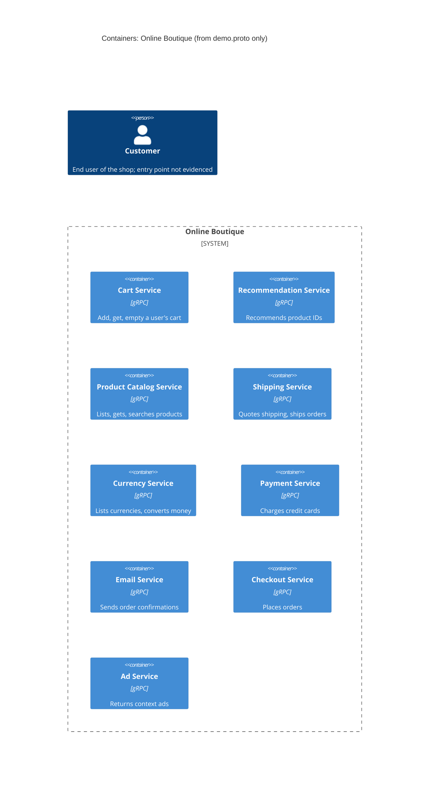

# 1A: Recovered architecture (evidence: `demo.proto` only)

## 1. Agent

Claude Code (Anthropic), model Claude Opus 5.5 (`claude-opus-5-5`).

## 2. Files read

- `prompts/1-recover-architecture.md` (task file)
- `system/online-boutique/protos/demo.proto` (evidence)

## 3. Containers table

All services are declared in proto package `hipstershop` (`demo.proto` line 17). The proto defines gRPC service interfaces (`service … { rpc … }`, `syntax = "proto3"`) only. It does **not** show the implementation language. `option go_package` (line 19) names the package for generated Go stubs, so it says nothing about how each service is implemented.

| Container | Technology / language | Responsibility | Evidence |
|---|---|---|---|
| Cart service | gRPC (proto3); language not evidenced | Add items to a user's cart, get the cart, empty the cart | `demo.proto` `service CartService` (`AddItem`, `GetCart`, `EmptyCart`), lines 23–27 |
| Recommendation service | gRPC (proto3); language not evidenced | Return recommended product IDs for a user and a list of products | `demo.proto` `service RecommendationService` (`ListRecommendations`), lines 56–58 |
| Product catalog service | gRPC (proto3); language not evidenced | List, get and search products (id, name, description, picture, price, categories) | `demo.proto` `service ProductCatalogService` (`ListProducts`, `GetProduct`, `SearchProducts`), lines 71–75; `message Product`, lines 77–87 |
| Shipping service | gRPC (proto3); language not evidenced | Quote shipping cost for an address and items; ship an order and return a tracking ID | `demo.proto` `service ShippingService` (`GetQuote`, `ShipOrder`), lines 107–110 |
| Currency service | gRPC (proto3); language not evidenced | List supported currencies; convert `Money` between ISO 4217 currencies | `demo.proto` `service CurrencyService` (`GetSupportedCurrencies`, `Convert`), lines 140–143 |
| Payment service | gRPC (proto3); language not evidenced | Charge a credit card for an amount; return a transaction ID | `demo.proto` `service PaymentService` (`Charge`), lines 177–179; `message CreditCardInfo`, lines 181–186 |
| Email service | gRPC (proto3); language not evidenced | Send an order confirmation to an email address | `demo.proto` `service EmailService` (`SendOrderConfirmation`), lines 199–201 |
| Checkout service | gRPC (proto3); language not evidenced | Place an order (user, currency, address, email, credit card) and return an `OrderResult` | `demo.proto` `service CheckoutService` (`PlaceOrder`), lines 224–226; `message PlaceOrderRequest`, lines 228–235 |
| Ad service | gRPC (proto3); language not evidenced | Return ads (text and redirect URL) for a set of context keywords | `demo.proto` `service AdService` (`GetAds`), lines 243–245 |

Data stores: **none are evidenced** in `demo.proto`. Message brokers: **none are evidenced**.

## 4. Dependencies table

A `.proto` file declares what each service **offers** (server side). It does not declare who **calls** whom. So `demo.proto` shows **no** runtime caller → callee dependency.

| Caller → callee | Protocol | Evidence |
|---|---|---|
| None evidenced | n/a | Not evidenced in the provided files |

Candidate dependencies suggested by shared message types are listed under **Gaps**. They are not in this table or the diagram.

## 5. Mermaid diagram

No `Rel` lines are drawn because the Dependencies table has no evidenced rows. The `Person` is included because the diagram format requires it. How the user reaches the system is not evidenced (see Gaps).

## 6. Gaps

| Gap | What `demo.proto` suggests | File that would settle it |
|---|---|---|
| Who calls whom (all runtime dependencies) | **[Inferred]** `PlaceOrderRequest` carries `credit_card`, `address`, `email`, `user_currency` (lines 228–235) and `OrderResult` carries `shipping_tracking_id` and `shipping_cost` (lines 208–214). This suggests `checkoutservice` calls cart, product catalog, currency, shipping, payment and email. | Checkout service source code, and `system/online-boutique/kubernetes-manifests/checkoutservice.yaml` (`*_SERVICE_ADDR` env vars) |
| Web front end / entry point for the user | No front-end service in the proto. **[Inferred]** Something must call `CartService`, `AdService`, `RecommendationService` and `CheckoutService` for the customer. | `system/online-boutique/kubernetes-manifests/frontend.yaml` and the front-end source code |
| User-facing protocol (HTTP/HTTPS?) | Not evidenced | Front-end manifest / source code |
| Recommendation → product catalog | **[Inferred]** `ListRecommendationsRequest` takes `product_ids` (line 62), so the service may look up the catalog | Recommendation service source code or its Kubernetes manifest |
| Cart storage (data store, e.g. a cache or database) | Not evidenced: cart state must live somewhere, but the proto shows no store | `system/online-boutique/kubernetes-manifests/` (cart service and any database manifest), cart service source code |
| Product catalog storage | Not evidenced | Product catalog service source code |
| Implementation language of each service | Not evidenced (`go_package` is only a stub-generation option) | Each service's source folder (`system/online-boutique/src/…`) or Dockerfile |
| External systems (real payment provider, mail server) | Not evidenced; the proto shows only internal interfaces | Payment and email service source code |
| Message brokers / asynchronous communication | Not evidenced; only unary gRPC RPCs are declared | Kubernetes manifests and service source code |
| Deployment (ports, replicas, service addresses) | Not evidenced | `system/online-boutique/kubernetes-manifests/` |
