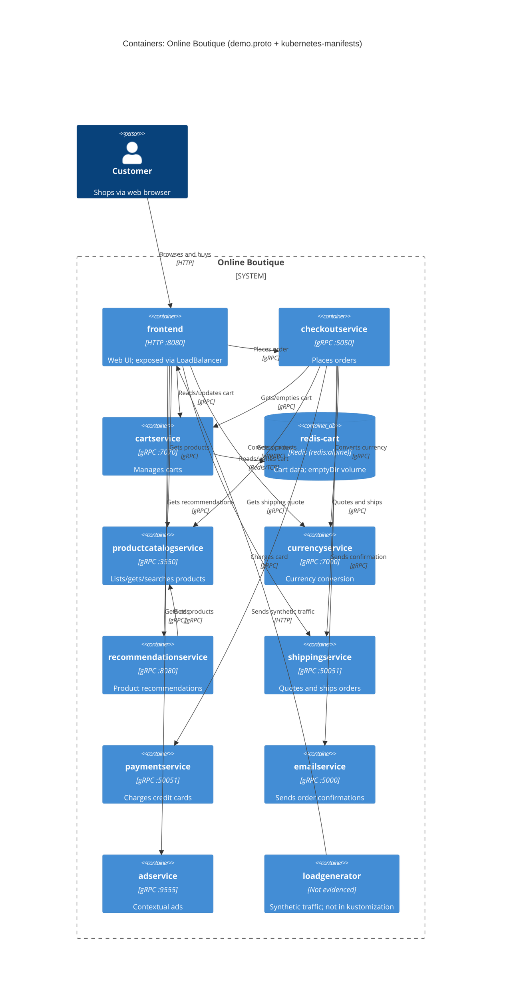

# 1B: Recovered architecture (evidence: `demo.proto` + `kubernetes-manifests/`)

## 1. Agent

Claude Code (Anthropic), model Claude Opus 5.5 (`claude-opus-5-5`).

## 2. Files read

- `prompts/1-recover-architecture.md` (task file)
- `exercise/01-recover-architecture.md`: only the run B message block (lines 20–24), to get the `evidence` input. The student explicitly allowed this. It was not used as architectural evidence.
- `system/online-boutique/protos/demo.proto`
- `system/online-boutique/kubernetes-manifests/` (all files): `adservice.yaml`, `cartservice.yaml`, `checkoutservice.yaml`, `currencyservice.yaml`, `emailservice.yaml`, `frontend.yaml`, `kustomization.yaml`, `loadgenerator.yaml`, `paymentservice.yaml`, `productcatalogservice.yaml`, `recommendationservice.yaml`, `shippingservice.yaml`, `README.md`

Paths below are shortened: `k8s/` = `system/online-boutique/kubernetes-manifests/`, `demo.proto` = `system/online-boutique/protos/demo.proto`.

## 3. Containers table

Every service's `image:` is a bare name (e.g. `image: frontend`). `k8s/README.md` says skaffold fills in the real tags, so the **implementation language of the services isn't evidenced**. "gRPC" below comes from the Service port named `grpc` together with gRPC `readinessProbe`/`livenessProbe`.

| Container | Technology / language | Responsibility | Evidence |
|---|---|---|---|
| frontend | HTTP server on 8080; language not evidenced | Web UI for the shop. Exposed outside the cluster | `k8s/frontend.yaml`: `httpGet /_healthz` probes; Service `frontend` (ClusterIP 80→8080); Service `frontend-external` (`type: LoadBalancer`, port 80) |
| cartservice | gRPC on 7070; language not evidenced | Add/get/empty a user's cart | `k8s/cartservice.yaml` (port `grpc` 7070); `demo.proto` `service CartService` L23–27 |
| redis-cart | Redis (`redis:alpine`) on 6379 | Data store for cart data. Volume is `emptyDir`, so data is lost when the pod is deleted | `k8s/cartservice.yaml`: Deployment `redis-cart`, `image: redis:alpine`, `volumes: redis-data: emptyDir: {}`; Service port `tcp-redis` 6379 |
| productcatalogservice | gRPC on 3550; language not evidenced | List/get/search products | `k8s/productcatalogservice.yaml` (port `grpc` 3550); `demo.proto` `service ProductCatalogService` L71–75 |
| currencyservice | gRPC on 7000; language not evidenced | Supported currencies; currency conversion | `k8s/currencyservice.yaml` (port `grpc` 7000); `demo.proto` `service CurrencyService` L140–143 |
| recommendationservice | gRPC on 8080; language not evidenced | Recommend product IDs | `k8s/recommendationservice.yaml` (port `grpc` 8080); `demo.proto` `service RecommendationService` L56–58 |
| shippingservice | gRPC on 50051; language not evidenced | Shipping quote; ship order and return tracking ID | `k8s/shippingservice.yaml` (port `grpc` 50051); `demo.proto` `service ShippingService` L107–110 |
| checkoutservice | gRPC on 5050; language not evidenced | Place an order | `k8s/checkoutservice.yaml` (port `grpc` 5050); `demo.proto` `service CheckoutService` L224–226 |
| paymentservice | gRPC on 50051; language not evidenced | Charge a credit card | `k8s/paymentservice.yaml` (port `grpc` 50051); `demo.proto` `service PaymentService` L177–179 |
| emailservice | gRPC, Service port 5000 → container 8080; language not evidenced | Send order confirmation | `k8s/emailservice.yaml` (Service port `grpc` 5000, `targetPort: 8080`); `demo.proto` `service EmailService` L199–201 |
| adservice | gRPC on 9555; language not evidenced | Return ads for context keywords | `k8s/adservice.yaml` (port `grpc` 9555); `demo.proto` `service AdService` L243–245 |
| loadgenerator | Language not evidenced (init container uses `busybox`) | Generates synthetic user traffic against the frontend (`USERS=10`, `RATE=1`). Not part of the default deployment: commented out in `kustomization.yaml` | `k8s/loadgenerator.yaml` (`FRONTEND_ADDR`, `USERS`, `RATE`); `k8s/kustomization.yaml` L24 `# - loadgenerator.yaml` |

Message brokers: **none evidenced**.

## 4. Dependencies table

Each `*_SERVICE_ADDR` env var gives a `host:port` that matches the callee's Service name and its `grpc` port. That is the basis for "gRPC".

| Caller → callee | Protocol | Evidence |
|---|---|---|
| Customer → frontend | HTTP (port 80) | `k8s/frontend.yaml` Service `frontend-external`, `type: LoadBalancer`, port `http` 80→8080 |
| frontend → productcatalogservice | gRPC | `k8s/frontend.yaml` `PRODUCT_CATALOG_SERVICE_ADDR=productcatalogservice:3550` |
| frontend → currencyservice | gRPC | `k8s/frontend.yaml` `CURRENCY_SERVICE_ADDR=currencyservice:7000` |
| frontend → cartservice | gRPC | `k8s/frontend.yaml` `CART_SERVICE_ADDR=cartservice:7070` |
| frontend → recommendationservice | gRPC | `k8s/frontend.yaml` `RECOMMENDATION_SERVICE_ADDR=recommendationservice:8080` |
| frontend → shippingservice | gRPC | `k8s/frontend.yaml` `SHIPPING_SERVICE_ADDR=shippingservice:50051` |
| frontend → checkoutservice | gRPC | `k8s/frontend.yaml` `CHECKOUT_SERVICE_ADDR=checkoutservice:5050` |
| frontend → adservice | gRPC | `k8s/frontend.yaml` `AD_SERVICE_ADDR=adservice:9555` |
| checkoutservice → productcatalogservice | gRPC | `k8s/checkoutservice.yaml` `PRODUCT_CATALOG_SERVICE_ADDR=productcatalogservice:3550` |
| checkoutservice → shippingservice | gRPC | `k8s/checkoutservice.yaml` `SHIPPING_SERVICE_ADDR=shippingservice:50051` |
| checkoutservice → paymentservice | gRPC | `k8s/checkoutservice.yaml` `PAYMENT_SERVICE_ADDR=paymentservice:50051` |
| checkoutservice → emailservice | gRPC | `k8s/checkoutservice.yaml` `EMAIL_SERVICE_ADDR=emailservice:5000` |
| checkoutservice → currencyservice | gRPC | `k8s/checkoutservice.yaml` `CURRENCY_SERVICE_ADDR=currencyservice:7000` |
| checkoutservice → cartservice | gRPC | `k8s/checkoutservice.yaml` `CART_SERVICE_ADDR=cartservice:7070` |
| recommendationservice → productcatalogservice | gRPC | `k8s/recommendationservice.yaml` `PRODUCT_CATALOG_SERVICE_ADDR=productcatalogservice:3550` |
| cartservice → redis-cart | Redis protocol over TCP 6379 | `k8s/cartservice.yaml` `REDIS_ADDR=redis-cart:6379`; Service port `tcp-redis` |
| loadgenerator → frontend | HTTP | `k8s/loadgenerator.yaml` `FRONTEND_ADDR=frontend:80`; init container `wget http://${FRONTEND_ADDR}` |

The env vars show **configured** addresses. That the code actually calls each one at runtime (and which RPCs it calls) is **[Inferred]**; source code would confirm it.

## 5. Mermaid diagram

Rel labels (e.g. "Charges card") come from the callee's RPCs in `demo.proto`. Which RPCs each caller actually uses is **[Inferred]**.

## 6. Gaps

| Gap | What would settle it |
|---|---|
| **`shoppingassistantservice`**: `frontend.yaml` sets `SHOPPING_ASSISTANT_SERVICE_ADDR=shoppingassistantservice:80`, but no manifest in the evidence deploys it, `demo.proto` has no such service, and `ENABLE_ASSISTANT` is commented out. Whether it exists or gets called is unknown, so it is left out of the diagram | frontend source (where the env var is used); the manifest for that service |
| **Implementation language** of every service (images have no tags or registry) | Each service's `Dockerfile` / source folder, or `skaffold.yaml` |
| **Which RPCs each caller uses**, and whether every configured address is actually called | Caller source code (e.g. checkoutservice, frontend) |
| **HTTPS / TLS** on the external endpoint: only HTTP port 80 is evidenced | Ingress / gateway / Istio configs (not in evidence) |
| **Product catalog data source**: no data store or volume is configured for `productcatalogservice` | productcatalogservice source |
| **Real external payment/email providers**: no external endpoints are configured for `paymentservice` or `emailservice` | Their source code |
| **Optional components**: `packaging service` (`PACKAGING_SERVICE_URL`) and `cymbal-branding` are commented out | `kustomize/components/` and frontend source |
| **Durability of cart data**: `emptyDir` means data is lost on pod restart. Whether that is intended for production is unknown | Production / release manifests (`k8s/README.md` points to `/release`) |
